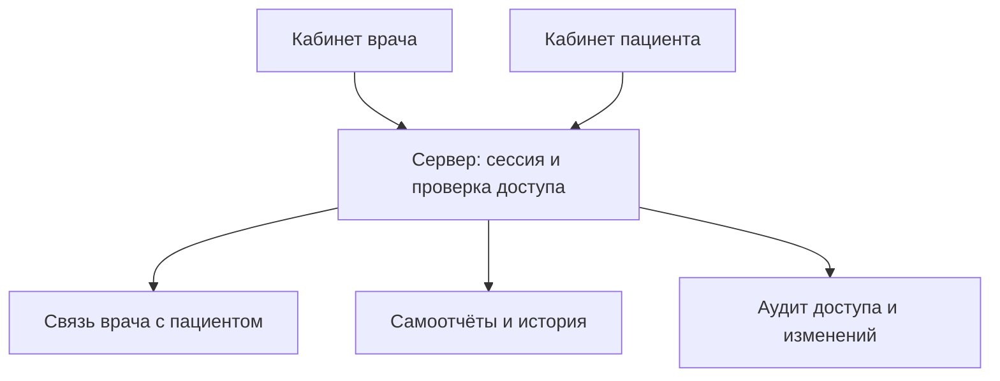

# Минимальная архитектура

Статус: первый серверный срез реализован и проверен в WORK-0008, 2026-10-21. Основания продукта — [PDF](../sources/README.md) и [брейншторм](../product/brainstorm.md). Действующий стек [ADR-0002](decisions/0002-backend-stack.md): Django/DRF/allauth, PostgreSQL, Gunicorn/WhiteNoise, Docker Compose. [ADR-0001](decisions/0001-documentation-first.md) сохраняет историю первоначального документационного этапа. Границы — [SPEC-001](../../specs/001-access-and-self-report/spec.md), результаты — [отчёт WORK-0008](../../docs/quality/reports/2026-10-21-work-0008.md).

## Что необходимо первому срезу

Использовать самое простое приложение, достаточное для этих действий. Не выделять отдельные сервисы и расширяемые платформы без необходимости. Технические контракты описаны в [плане среза](../../specs/001-access-and-self-report/plan.md).

| Данные сейчас | Зачем нужны |
| --- | --- |
| Пользователь и роль | Определить врача/пациента из серверной сессии — CON-001 |
| Минимальные профили | Связать пользователя с врачом или пациентом, без лишних полей |
| Связь ведущего врача с пациентом | Ограничить доступ и передать самоотчёт в нужную карточку — CON-002 |
| Самоотчёт | Автор, пациент, время наблюдения и записи, текст, ключ повторной отправки — FR-005 |
| Аудит | Зафиксировать доступ, изменения и отказы без текста самоотчёта — CON-010, NFR-013 |

Схема реализована миграциями accounts/care/reports/audit. Имя, роль и допуск находятся в User без лишних отдельных профилей; дополнительно Django/allauth хранят сессии, подтверждение адреса и общие счётчики ограничений. Точные поля и API — в плане SPEC-001. Код сервера находится в backend, HTML/CSS/JS — в frontend; корень репозитория и исходные материалы HTTP-сервер не публикует.

## Доступ

| Действие | Пациент | Ведущий врач | Несвязанный врач |
| --- | --- | --- | --- |
| Читать самоотчёты пациента | Только свои | Только связанного пациента | Нет |
| Создать самоотчёт | Только свой | Не от имени пациента | Нет |
| Изменить связь через публичный запрос | Нет | Нет | Нет |

Сервер проверяет роль, принадлежность данных и текущую связь на каждом чтении и изменении, включая вложенный ресурс. Не доверять `patient_id`, `doctor_id` или роли из формы. Связь задаётся и отзывается служебной командой оператора с аудитом; пациент не выбирает ведущего врача. Одобрение врача отдельно от подтверждения почты. После отзыва допуска или связи прежний врач теряет доступ при следующем запросе. Необязательный seed создаёт только вымышленные аккаунты и не перезаписывает существующие.

Ответы о чужом объекте не раскрывают его существование. Медицинский текст не попадает в обычные логи и ошибки. Повторная отправка не создаёт второй самоотчёт; сохранение и аудит создания выполняются одной транзакцией.

Контакты психиатра и доверенного лица из брейншторма не означают доступ этих лиц к медицинской карте. Сейчас дополнительный способ предоставления такого доступа не проектируется.

## Ограничения для следующих задач

- Клинические действия требуют явного подтверждения конкретного предложения ведущим врачом — CON-003. До этого терапия, план и направление не меняются.
- Алерты должны выявлять согласованные критические признаки и оповещать врача — CON-005. Надёжность, задержка и сохранность событий проверяются по NFR-001 и NFR-007; механизм выбирается при задаче алертинга, не заранее.
- Шкалы, лекарственные сведения и правила используют проверенные источники и версии — CON-007, CON-008, NFR-010. Отсутствующие данные не додумываются.
- FR-009 и NFR-002 требуют оценки извлечения ключевых сведений из историй болезни разных шаблонов. Формат данных и минимальный способ обработки уточняются соответствующей задачей.
- Структуру остальных возможностей из PDF и брейншторма проектировать, когда они необходимы текущему результату. Не создавать дополнительные модели, модули и зависимости впрок.

Перед реальными данными нужны проверенные условия хранения, передачи, доступа и восстановления. Текущая задача использует только вымышленные сведения и не удостоверяет готовность к реальному применению.

Аккаунты используют серверные cookie-сессии, Argon2id и CSRF; app-token API и административный вход не включены. UI/API одного origin; безопасные HTTPS-настройки включены по умолчанию, локальный HTTP разрешён явным dev-режимом. Контейнер приложения работает с UID 10001; PostgreSQL имеет named volume. Проверены отказ БД, перезапуск, пересоздание контейнеров и восстановление синтетической копии. Это локальная проверка, без утверждения о производственных RPO/RTO.

## ИИ-ассистент WORK-0016

[ADR-0004](decisions/0004-ai-assistant.md): тот же Django и PostgreSQL, серверный HTTPS-вызов Polza без SDK. Новые таблицы хранят ходы одного пациентского диалога, попытки и внутренние синтетические уведомления; сетевой вызов вне транзакции, блокировка строки пациента защищает лимиты между worker. Ключ только окружением. Врач получает только уведомления пациентов с текущей связью, без общей истории чата. Клинический детектор отключён. Контракты — [SPEC-005](../../specs/005-ai-assistant/plan.md).
